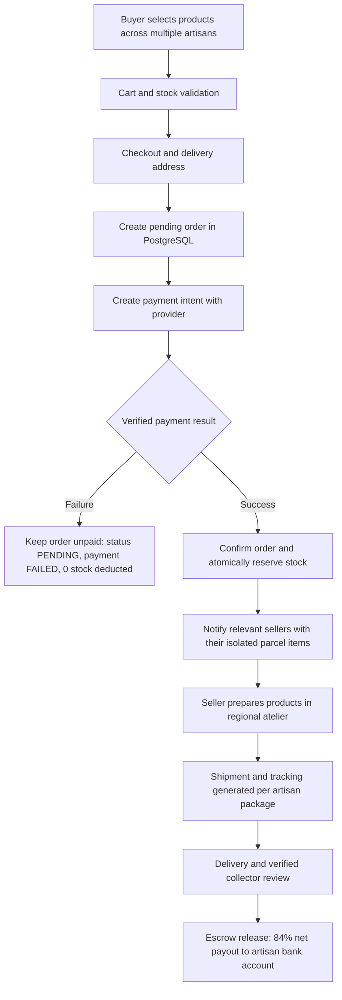

# ARTISANLY --- Multi-Vendor Marketplace Payments, Orders & Checkout Architecture

> Technical Architecture, Regulatory Compliance Review, and Payment Provider Investigation for Multi-Vendor E-Commerce in India.

---

## 1. Executive Summary: Transforming Portfolio into a Functioning Marketplace

A single-vendor e-commerce store is simple: an order maps to a single warehouse, a single courier parcel, and a single bank account. 

**ARTISANLY is fundamentally different.** It is a decentralized artisan marketplace connecting patrons and collectors directly with rural master artisans and traditional guilds across India. A single cart can include:
- **Blue Pottery** handcrafted in Jaipur, Rajasthan (Seller A).
- **Pipli Applique Embroidery / Pattachitra Painting** created in Raghurajpur, Odisha (Seller B).
- **Dhokra Bell Metal Casting** forged in Bastar, Chhattisgarh (Seller C).

When the buyer completes checkout, ARTISANLY must:
1. **Allocate items** into isolated workshop packages for each artisan.
2. **Calculate multi-origin shipping** reflecting independent regional dispatch.
3. **Execute split settlements** reserving 84% net payout to the rural artisans, deducting 15% platform commission and 1% Section 194-O statutory TDS.
4. **Hold funds in regulatory escrow** until delivery is confirmed and inspection windows expire.
5. **Handle partial fulfillments gracefully** without breaking the contract of innocent sellers when one artisan experiences studio delay or workshop damage.

---

## 2. End-to-End Architecture Flowchart Walkthrough



### Detailed Lifecycle Steps

| Step | Flowchart Action | Invariant & Database State | UI & Notification Behavior |
| :--- | :--- | :--- | :--- |
| **1** | **Buyer selects products** | Cart stored in localStorage / persistent guest session token. Multi-seller items bundled seamlessly. | Interactive shopping bag displaying craft tradition, artisan workshop, and verified badges. |
| **2** | **Cart and stock validation** | Server checks `Inventory.quantity >= requested`. Prices verified from live catalog in integer minor units (paise). | Inline stock warning if an atelier has low availability; real-time validation prevents checkout of stale items. |
| **3** | **Checkout & delivery address** | Captures complete PAN-India shipping address, mobile phone (for delivery OTP), and email. | Pre-fills patron address; validates PIN code and state for regional routing. |
| **4** | **Create pending order** | Order created in PostgreSQL: `status: PENDING`, `paymentStatus: PENDING`, `shipmentStatus: PENDING`. Distinct `Shipment` packages created per `sellerId`. **Zero inventory decremented. Zero sellers alerted.** | Spinner: "Creating Pending Order in PostgreSQL...". Order number generated: `ART-YYYY-XXXXXXXX`. |
| **5** | **Create payment with provider** | Payment intent initialized with gateway (Razorpay Order ID or Sandbox Reference). Zero card details touch our server. | Presents UPI QR / Apps (Google Pay, PhonePe, Paytm), 3D-Secure Cards, or NetBanking. |
| **6A** | **Payment Result: FAILURE** | Invariant: `paymentStatus: FAILED`. Order remains `status: PENDING` (unpaid). **Stock remains 100% untouched. No sellers alerted.** | Displays clear error message with retry button. Patron does not lose cart or duplicate order records. |
| **6B** | **Payment Result: SUCCESS** | Invariant: Server verifies HMAC-SHA256 signature. `status: CONFIRMED`, `paymentStatus: COMPLETED`. Inventory atomically decremented. Settlement ledger recorded (84% net, 15% commission, 1% TDS). | Patron redirected to confirmation screen displaying multi-package tracking summary. |
| **7** | **Notify relevant sellers** | Dispatches `sendSellerOrderAlertEmail` to **each distinct seller containing ONLY their items and customer delivery details.** | Rural artisans receive email / SMS notification to begin preparing the piece in sustainable eco-packaging. |
| **8** | **Seller prepares products** | Seller updates package fulfillment status to `PROCESSING` ("In atelier preparation / kiln finishing"). | Status updates in buyer dashboard: "In Kiln / Atelier Finishing". |
| **9** | **Shipment and tracking** | Seller enters logistics carrier (e.g., BlueDart, India Post) and AWB number. Package status becomes `SHIPPED`. | Automated dispatch email dispatched to buyer with live courier tracking link. |
| **10** | **Delivery & Review** | Courier delivers package; status becomes `DELIVERED`. Patron receives prompt for verified purchase review. | Funds unlocked from Escrow Hold for T+2 direct settlement into artisan's verified bank account. |

---

## 3. Investigation of Payment Providers for Marketplace Model

### 3.1 Razorpay Route (Recommended Provider)

[Razorpay Route](https://razorpay.com/docs/payments/route/) is Razorpay’s purpose-built product for marketplace split settlements, vendor management, and automated escrow payouts under Indian banking regulations.

#### A. Linked Accounts Architecture
1. **Standard Linked Accounts**: Artisans complete a standardized Razorpay onboarding form to submit bank account and KYC documents.
2. **Custom Linked Accounts (`POST /v1/accounts`)**:
   - ARTISANLY manages the onboarding UI directly inside the Studio Dashboard.
   - We collect Account Holder Name, Bank Account Number, IFSC code, and PAN.
   - We register the linked account via API, returning an `acc_XXXXXXXXXXXXXX` identifier mapped to `SellerProfile.id`.
   - **Advantage for Artisans**: Keeps rural artisans in the familiar ARTISANLY interface without requiring external portal logins.

#### B. Payment Splitting & Transfers
Razorpay Route supports two payment split paradigms:
1. **Auto-Transfers on Order Creation (Recommended for Cart Checkout)**:
   When creating the Razorpay Order via `POST /v1/orders`, we pass the `transfers` array:
   ```json
   {
     "amount": 252699,
     "currency": "INR",
     "transfers": [
       {
         "account": "acc_rajasthan_01",
         "amount": 21336,
         "currency": "INR",
         "on_hold": 1,
         "notes": {
           "orderNumber": "ART-2026-F8A3C91D",
           "sellerShopName": "Devendra Terracotta Works",
           "deductions": "15% platform commission + 1% Section 194-O TDS"
         }
       },
       {
         "account": "acc_odisha_02",
         "amount": 201600,
         "currency": "INR",
         "on_hold": 1,
         "notes": {
           "orderNumber": "ART-2026-F8A3C91D",
           "sellerShopName": "Raghurajpur Heritage Guild",
           "deductions": "15% platform commission + 1% Section 194-O TDS"
         }
       }
     ]
   }
   ```
2. **Direct Transfers via API (`POST /v1/payments/{payment_id}/transfers`)**:
   Alternatively, collect the entire payment into the platform escrow account first, then trigger transfers programmatically once verified.

#### C. Settlement Hold (`on_hold: 1`)
Under RBI regulations and consumer protection rules, marketplaces must prevent premature payouts before goods are delivered.
- Razorpay Route allows setting `on_hold: 1` during the transfer.
- The funds remain securely locked in the RBI Nodal/Escrow account.
- Once the courier tracking confirms `DELIVERED` (or after the 7-day return inspection period), our system calls:
  ```http
  POST /v1/transfers/{transfer_id}
  { "on_hold": 0 }
  ```
- Razorpay releases the net 84% funds directly to the artisan’s bank account on the next business day (T+1 / T+2).

#### D. Transfer Reversals & Refunds (`POST /v1/transfers/{transfer_id}/reversals`)
If an order or individual artisan package is cancelled before dispatch:
- Our system calls the transfer reversal endpoint.
- Funds are pulled back from the seller's pending transfer back to platform escrow.
- Razorpay initiates an instant refund back to the buyer's original payment source (UPI account or card).

#### E. Access & Onboarding Approval Prerequisites
Razorpay restricts Route activation to vetted businesses. Before live marketplace payments can be toggled on:
- [x] Company Incorporation Certificate & Commercial Registry (CIN).
- [x] Platform Company PAN & GSTIN registration.
- [x] Nodal / Escrow Bank Account agreement with a scheduled commercial bank (e.g., HDFC / ICICI).
- [x] Approved Merchant Category Code: **MCC 5971 / 5970** (Art Dealers, Galleries, and Craft Specialties).
- [x] Terms of Service & Privacy Policy publishing statutory refund, return, and cancellation policies.

---

### 3.2 Comparison with Other Providers in the Indian Market

| Provider / Feature | **Razorpay Route** | **Cashfree Easy Split** | **Stripe Connect (India)** | **PayU Split** |
| :--- | :--- | :--- | :--- | :--- |
| **Marketplace Settlement** | Native multi-vendor split | Native multi-vendor split | Restricted / Limited in India | Available upon approval |
| **Vendor Onboarding** | Custom Linked Accounts via API | Vendor API & Instant Penny Drop | Restricted Custom Accounts | Manual merchant dashboard |
| **Settlement Hold (Escrow)** | Yes (`on_hold: 1`) | Yes (Settlement delay) | Limited | Manual release |
| **Section 194-O TDS Support** | Automated split / ledger | Automated split / ledger | Manual reporting | Manual reporting |
| **UPI Intent & Autopay** | Full (GPay, PhonePe, BHIM) | Full UPI stack | Credit cards primarily | Full UPI stack |
| **Indian Regulatory Fit** | **Optimal** (Fully compliant) | **Strong Alternative** | **Poor** (Cross-border focus) | Moderate |

**Verdict:** **Razorpay Route** is the gold standard for Indian artisan marketplaces due to its deep integration with Indian UPI, automated Section 194-O TDS deductions, and native settlement hold primitives. **Cashfree Easy Split** serves as an excellent secondary fallback.

---

## 4. Compliance with the 6 Production Payment Rules

### Rule 1: Never Trust a Payment-Success Message From the Browser Alone
* **The Vulnerability**: A malicious user can intercept client-side JavaScript, forge an HTTP response, or manipulate redirect query parameters (e.g., `?payment_status=success&order_id=123`) to mark an order as paid without transferring funds.
* **ARTISANLY Enforcement**: The browser’s role ends at submitting the gateway payment reference (`razorpayPaymentId`, `razorpayOrderId`, `razorpaySignature`) to our secure Route Handler `/api/payments/verify`. The database `Order` remains strictly `PENDING` until our server verifies the transaction.

### Rule 2: Verify Payment Results Through Server-Side API and Signed Webhooks
* **Server Verification**: In `/api/payments/verify`, our server validates the cryptographic HMAC-SHA256 signature using the secret key (`process.env.RAZORPAY_KEY_SECRET`), which is never exposed to the client:
  $$\text{HMAC-SHA256}(\text{order\_id} \parallel "|" \parallel \text{payment\_id}, \text{secret}) \equiv \text{signature}$$
* **Signed Webhooks**: In `/api/payments/webhook`, incoming gateway events (`payment.captured`, `payment.failed`, `refund.processed`) must carry a valid `X-Razorpay-Signature` matching the raw request body.

### Rule 3: Use Idempotency and Duplicate-Event Protection
* **The Risk**: Network retries, webhooks re-deliveries, or rapid double-clicking by a buyer can cause an order to be charged twice or inventory to be decremented multiple times.
* **ARTISANLY Enforcement**:
  1. Every incoming webhook event ID (`payload.id`) or client verification attempt is checked against `AuditLog` records.
  2. If the event ID was previously processed, the endpoint immediately returns HTTP 200 `{ duplicate: true }` without touching database inventory or re-charging the buyer.
  3. `confirmOrderAndReserveStock` checks if `order.paymentStatus === "COMPLETED"` before executing inventory decrements.

### Rule 4: Record Commissions, Refunds, Cancellations, Disputes, and Seller Settlements
* **Monetary Conservation Rule**: For every gross rupee received:
  $$\text{Gross Sale (Paise)} = \text{Net Artisan Remittance (84%)} + \text{Platform Commission (15%)} + \text{Section 194-O TDS (1%)}$$
* **Integer Minor Units**: Stored as integer paise (`Int`) across all Prisma models. Floating-point IEEE 754 numbers are strictly prohibited.
* **Dedicated Ledgers**: Every transaction writes immutable financial records to `payments`, `payouts`, and `audit_logs` tracking:
  - Gross sales per artisan
  - Platform commission fees
  - Statutory TDS withheld
  - Pending escrow balance vs disbursed payouts
  - Dispute and refund debits

### Rule 5: Never Store Raw Card Details or Expose Secret API Keys
* **PCI-DSS Compliance**: ARTISANLY servers **never see, receive, or store raw 16-digit Primary Account Numbers (PAN), CVVs, or card PINs.**
* All card processing happens inside the payment gateway's PCI-DSS Level 1 certified iframe or UPI intent modal.
* ARTISANLY only stores tokenized transaction identifiers (`pay_...`, `ref_...`).
* `RAZORPAY_KEY_SECRET` and `PAYMENT_WEBHOOK_SECRET` are kept strictly in server-side environment variables and excluded from client bundles.

### Rule 6: Defined Protocol for Multi-Seller Partial Fulfillment
* **The Challenge**: A buyer orders a Terracotta Vase from Rajasthan and a Pattachitra Scroll from Odisha. The Rajasthan artisan is ready to ship, but the Odisha artisan suffers workshop kiln damage and cannot fulfill the scroll.
* **ARTISANLY Partial Fulfillment Protocol**:
  1. **Item-Level Statuses**: Each `OrderItem` has its own independent `status` (`CONFIRMED`, `PROCESSING`, `SHIPPED`, `DELIVERED`, `CANCELLED`).
  2. **Package Isolation**: Each artisan has an independent `Shipment` record with its own carrier, AWB tracking number, and dispatch date.
  3. **Cancellation & Inventory Release**: The unfulfillable artisan triggers cancellation from their Studio Dashboard (`PATCH /api/seller/orders/[id]` with `action: "CANCEL_ITEM"`). Stock for that item is immediately restored to inventory.
  4. **Pro-Rata Buyer Refund**: A partial refund is generated in `payments` (`status: REFUNDED`) for the unfulfillable item's value plus proportional tax/shipping. The buyer is notified via `sendOrderRefundedEmail`.
  5. **Protected Artisan Settlement**: The innocent artisan (Rajasthan) is completely unaffected: their package continues to dispatch, and their full 84% payout is protected in escrow.
  6. **Overall Order State**: The order transitions to partial fulfillment without breaking the overall transaction.

---

## 5. Development Strategy: Simulated Checkout vs. Live Gateway

```
[UI / Feature Development]
       │
       ▼
[Sandbox Simulator: /api/payments/sandbox & /api/payments/verify]
       │  (Tests success branch, failure branch, stock reservation, multi-vendor alerts)
       ▼
[ आर्टिसन Seller Onboarding & Bank Account Verification (Penny Drop)]
       │
       ▼
[Partial Fulfillment & Refund Edge Cases Tested]
       │
       ▼
[Corporate KYB, Merchant Category Code 5971 & RBI Escrow Approval]
       │
       ▼
[Production Gateway Toggled ON: PAYMENT_GATEWAY_MODE=live]
```

By maintaining a realistic development simulator that executes the **exact verified state machine** (validating stock, creating pending orders, testing failure vs success branches, deducting inventory, and notifying sellers), development proceeds rapidly and safely without prematurely incurring gateway transaction fees or risking live funds.

---

## 6. Summary of Implementation in ARTISANLY Codebase

| Component | File Path | Responsibility |
| :--- | :--- | :--- |
| **Order & Settlement Engine** | [`src/lib/payments/orders.ts`](file:///c:/Users/sidsm/PROJECTS/ARTSINLY/src/lib/payments/orders.ts) | Multi-vendor allocation, stock reservation, settlement calculation, partial cancellation |
| **Pending Order Creation** | [`src/app/api/orders/route.ts`](file:///c:/Users/sidsm/PROJECTS/ARTSINLY/src/app/api/orders/route.ts) | Flowchart Step 4: Creates pending order without premature stock deduction or premature seller alerts |
| **Server Payment Verification** | [`src/app/api/payments/verify/route.ts`](file:///c:/Users/sidsm/PROJECTS/ARTSINLY/src/app/api/payments/verify/route.ts) | Flowchart Step 6: Cryptographic HMAC verification, idempotency guard, confirmed order transition |
| **Sandbox Simulator** | [`src/app/api/payments/sandbox/route.ts`](file:///c:/Users/sidsm/PROJECTS/ARTSINLY/src/app/api/payments/sandbox/route.ts) | Interactive sandbox testing both success and failure branches with non-guessable identifiers |
| **Signed Webhook Listener** | [`src/app/api/payments/webhook/route.ts`](file:///c:/Users/sidsm/PROJECTS/ARTSINLY/src/app/api/payments/webhook/route.ts) | Production signed webhook listener with HMAC signature verification and deduplication |
| **Seller Fulfillment & Cancellation** | [`src/app/api/seller/orders/[id]/route.ts`](file:///c:/Users/sidsm/PROJECTS/ARTSINLY/src/app/api/seller/orders/[id]/route.ts) | Multi-package fulfillment tracking & Rule 6 partial fulfillment cancellation protocol |
| **Multi-Vendor Cart UI** | [`src/app/cart/page.tsx`](file:///c:/Users/sidsm/PROJECTS/ARTSINLY/src/app/cart/page.tsx) | Segregates items into distinct artisan atelier parcels with multi-origin courier transparency |
| **Multi-Vendor Checkout UI** | [`src/app/checkout/page.tsx`](file:///c:/Users/sidsm/PROJECTS/ARTSINLY/src/app/checkout/page.tsx) | Interactive flowchart checkout with toggle for testing failure vs success branches |
| **Seller Order Dashboard** | [`src/app/seller/dashboard/page.tsx`](file:///c:/Users/sidsm/PROJECTS/ARTSINLY/src/app/seller/dashboard/page.tsx) | Package fulfillment tracking and "Unable to Fulfill Item" partial refund trigger |
| **Comprehensive Test Suite** | [`scripts/test_multivendor_checkout_and_payments.js`](file:///c:/Users/sidsm/PROJECTS/ARTSINLY/scripts/test_multivendor_checkout_and_payments.js) | 34 automated unit/integration tests verifying all flowchart steps and production payment rules |
